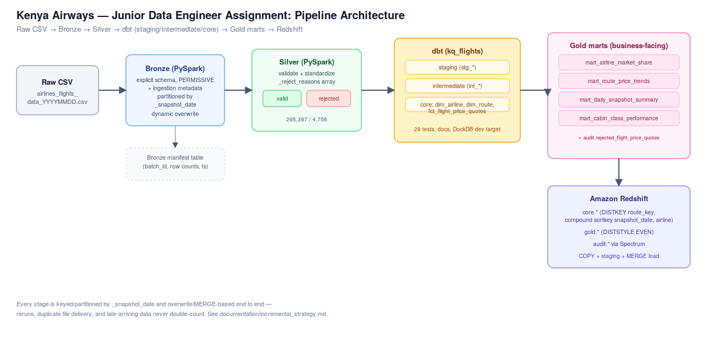

# Flight Pricing Lakehouse Pipeline
### Bronze → Silver → dbt → Redshift (PySpark, dbt, pytest)

Built as a data engineering take-home exercise for a Kenya Airways junior data engineer role. **Author:** Amos Muthomi
**Dataset:** `airlines_flights_data.csv` (300,153 rows, Indian domestic flight fare quotes)

## Quick orientation

| Folder | Contents |
|---|---|
| `architecture/` | Architecture diagram (`.svg` / `.png`) |
| `pyspark/bronze/` | Bronze ingestion job |
| `pyspark/silver/` | Silver validation/transformation job |
| `dbt/kq_flights/` | dbt project: staging → intermediate → core marts → Gold marts |
| `redshift/` | Redshift DDL + design rationale + load strategy |
| `tests/pyspark/` | pytest suite for the Bronze and Silver jobs (9 tests) |
| `documentation/` | Assumptions, data-quality findings, incremental strategy, monitoring design, exact reproduction steps |
| `data/raw/` | Where to put the public source CSV (not committed; see the README in that folder) |

**Start here to verify everything runs:** `documentation/reproduction_steps.md`
has the exact commands and the exact numbers you should see at each stage —
everything in this submission was actually executed, not just written.

## Architecture

Raw CSV → Bronze (PySpark, raw + metadata, partitioned by snapshot date) →
Silver (PySpark, validated/standardized, split into valid + rejected with
reasons) → dbt (staging → intermediate → core dimensional model) → Gold (four
business-facing marts) → Redshift (native tables, tuned DISTKEY/SORTKEY,
loaded via COPY + MERGE).



## The one thing worth reading first: the data isn't as clean as it looks

The file has zero nulls and zero exact duplicates, but profiling it turned up a
genuine, non-obvious issue: **4,756 Indigo flight codes (1.58% of the whole
file)** are corrupted by what looks like an Excel scientific-notation bug —
`6E-5214`-type codes got saved back out as `6.00E-269`. Because the corruption
is lossy (the exponent doesn't map back to the original code), Silver rejects
these with a specific, named reason rather than guessing a replacement value.
Full write-up: `documentation/data_quality_report.md`.

## Key assumption (affects the whole design)

This dataset has no flight date, only `days_left` (booking lead time at scrape
time). The whole incremental/partitioning design treats each file as one day's
price-scrape snapshot (`snapshot_date`, derived from the filename). This is
spelled out fully, along with every other assumption made, in
`documentation/assumptions.md`.

## What's demonstrated where (mapped to the assignment brief)

| Brief section | Where it's addressed |
|---|---|
| §3 Bronze | `pyspark/bronze/bronze_ingest.py` |
| §4 Silver | `pyspark/silver/silver_transform.py`, `documentation/data_quality_report.md` |
| §5 dbt modelling | `dbt/kq_flights/` (staging/intermediate/marts, tests, docs, grain documented in model SQL headers) |
| §6 Gold marts | `dbt/kq_flights/models/marts/gold/` (4 marts, each with a business-question comment header) |
| §7 Redshift | `redshift/ddl_core_and_gold.sql`, `redshift/README.md` |
| §8 Incremental processing | `documentation/incremental_strategy.md` |
| §9 DQ & reconciliation | `documentation/data_quality_report.md` |
| §10 Monitoring | `documentation/monitoring.md` |
| §12 Assumptions | `documentation/assumptions.md` |

## Reproduced results (this run)

```
source rows (excl. header): 300153, rows parsed by Spark: 300153 (corrupt: 0)
total: 300153 valid: 295397 rejected: 4756 (1.58%)
  flight_code_excel_scientific_notation_corruption   4705
  flight_code_format                                 51
tests/pyspark: 9 passed
dbt build: PASS=40 WARN=0 ERROR=0 SKIP=0 NO-OP=0 REUSED=0 TOTAL=40
main_core.fct_flight_price_quotes row count: 295397
```

## Limitations / what I'd do differently with more time

- No live Redshift cluster was available, so the DDL and load strategy are
  design-reviewed but not execution-tested against a real cluster (dbt was
  run against DuckDB locally instead, using the identical SQL, to validate
  the model logic itself).
- The DQ rule set is intentionally scoped to what this specific file needed
  plus a realistic set of production-grade checks; a real production feed
  would likely surface additional issue types over time that aren't
  representable from a single static file.
- Orchestration (Airflow/Step Functions/etc.) isn't included — the brief
  scopes this to the transformation logic and design, not a scheduler.
